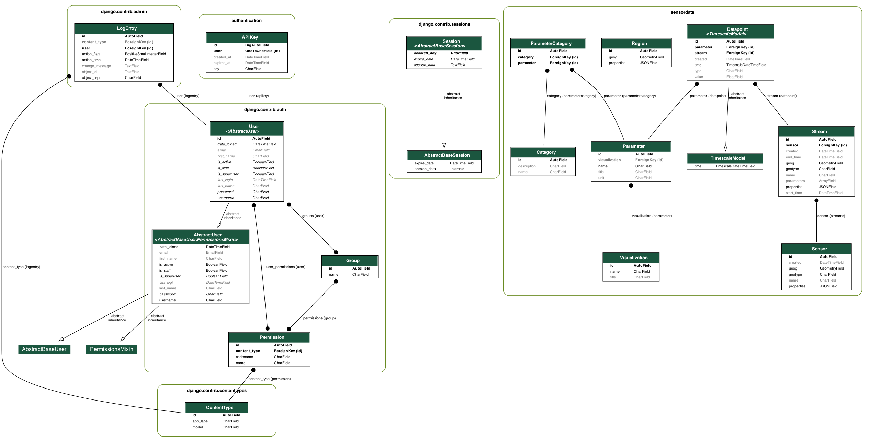

# Geostreams3 [Development]

[](https://github.com/psf/black)

[](https://github.com/geostreams/geostreams3/actions/workflows/django_tests.yml)

Geostreams3  is a RESTful web service to manage geospatial data streams. It integrates multiple tools and frameworks for
seamless data handling, processing and binning.

## Features
- User authentication and API key management and Django REST framework
- Geospatial data processing with TimescaleDB and PostGIS
- Continuous aggregates for optimized querying of large datasets.
- Frontend to allow users to register, login and procure API keys.

## Table of Contents

1. [Architecture Overview](#architecture-overview)
2. [Tools and Frameworks](#tools-and-frameworks)
3. [Setup Guide for Developers](#setup-guide-for-developers)
4. [API Testing with Bruno](#api-testing-with-bruno)

## Architecture Overview

The system is divided into 4 main components:

1. **API Layer**:
    - Django REST framework for the backend API.
    - Handles user authentication, API key management, and data processing.
    - Levarages TimescaleDB and PostGIS for geospatial data processing.
    - Provides endpoints for data ingestion, querying, and management.
    - Swagger documentation for API reference.

2. **Frontend**:
    - React frontend for user registration, login, and API key management.
    - Allows users to register, login, and manage their API keys.

3. **Databases**:
    - PostgreSQL database with TimescaleDB and PostGIS extensions.
    - Stores user data, API keys, and geospatial data streams.
    - Continuous aggregates for optimized querying of large datasets.
    - Used by Keycloak for store and persist user data.

4. **Keycloak**:
    - Open-source identity and access management for user authentication.
    - Provides user registration, login, and API key management.
    - Used to secure the API endpoints and manage user permissions.


## Tools and Frameworks
- Django REST framework: A powerful and flexible python toolkit for building Web APIs.
- Keycloak: An open-source identity and access management for user authentication.
- React: A JavaScript library for building user interfaces.
- TimescaleDB: An open-source time-series database optimized for fast ingest and complex queries.
- PostGIS: An open-source software program that adds support for geographic objects to the PostgreSQL object-relational database.
- Docker: A platform for developing, shipping, and running applications in containers.
- Docker Compose: A tool for defining and running multi-container Docker applications.
- Swagger: API documentation tool for RESTful web services.
- NGINX: Server for reverse proxy and load balancing.

## Setup Guide for Developers
### Prerequisites
- Docker and Docker Compose
- Node.js + npm (for frontend)
- Conda (Miniconda or Anaconda)

### 1. Clone the repository

```bash
git clone https://github.com/geostreams/geostreams3.git
cd geostreams3
```

### 2. Create environment files
Copy the current env templates:

```bash
cp .env.example .env
cp backend/.env-example backend/.env
cp frontend/.env-example frontend/.env
```

### 3. Start development infrastructure (database + Keycloak + Traefik)
For local development, start the infrastructure services from `docker-compose.dev.yml`:

```bash
docker-compose -f docker-compose.dev.yml up -d
```

This starts:
- TimescaleDB on `localhost:5433`
- Keycloak behind Traefik at `http://localhost/geostreams/keycloak`

If you run backend locally (outside Docker), update `backend/.env` to point to local ports/hosts, for example:
- `POSTGRES_HOST=localhost`
- `POSTGRES_PORT=5433`
- `KEYCLOAK_SERVER_URL=http://localhost/geostreams/keycloak/`

### 4. Run backend locally

```bash
cd backend
conda create -n geostreams3 python=3.12 -y
conda activate geostreams3
python -m pip install -r requirements.txt
python manage.py migrate
python manage.py runserver 9007
```

Backend will be available at `http://localhost:9007/geostreams/api/`.

### 5. Run frontend locally

```bash
cd frontend
npm install
npm start
```

Frontend will be available at `http://localhost:3000`.

### Optional: run full stack via production compose
`docker-compose.yml` starts a production-style stack and pulls prebuilt backend/frontend images:

```bash
docker-compose up -d
```

Use this mode when you want to run published images rather than local frontend/backend source code.

### Pre-commit Setup

To ensure code style consistency, install pre-commit hooks by running:

```bash
pre-commit install
```

This will automatically run checks such as Black formatting on every commit.

### Swagger Documentation

To access API documentation when running backend locally, open:

```
http://localhost:9007/geostreams/api/swagger/
```

## API Testing with Bruno
We use Bruno to manage and test our API requests.
Bruno is a modern, lightweight, and open-source API client designed to simplify API development and testing. It also
allows you to save and share API requests, collaborate with your team, and automate API testing.
All our API requests are saved in the collection `Geostreams3` inside the folder `bruno_api_requests`

Getting Started
	1.	Download Bruno
Download the Bruno API client from [here](https://www.usebruno.com/downloads.
	2.	Import Requests
Once installed, import the saved requests from the bruno_api_requests folder.
	3.	Set the Base URL
Make sure to configure the Base URL in Bruno’s environment settings to match your API environment (e.g., development, staging, production).
    4.	Run Requests
      Run the requests to test the API endpoints and verify the responses.


## Model Diagram

Need to install graphvis in the system and pydotplus in the python environment. Also enable django_extensions in the settings.py file.

```bash
python manage.py graph_models --all-applications --output model_diagram.png
```


